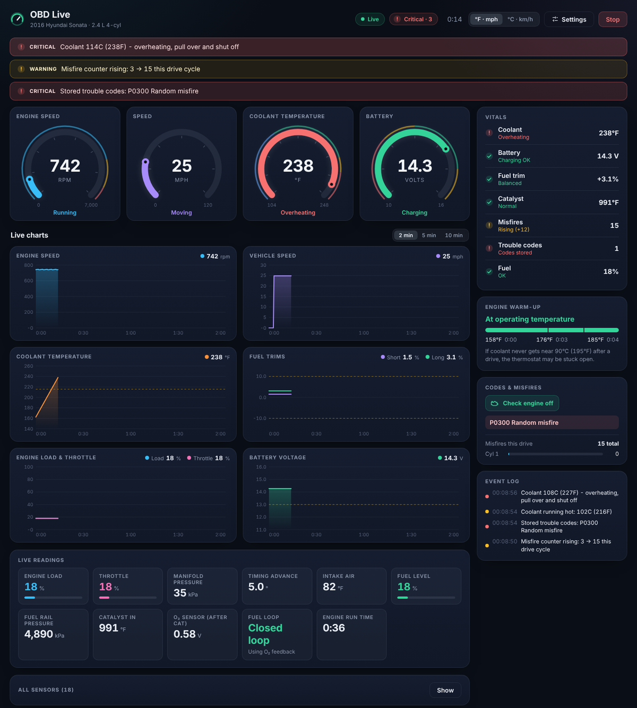
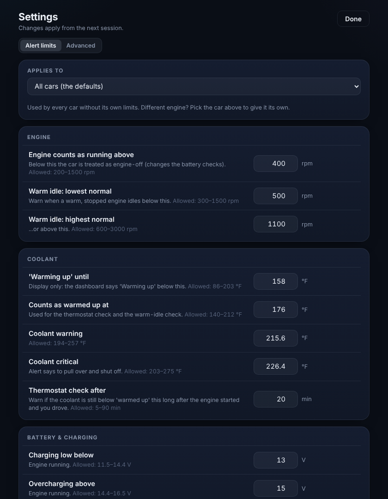

# OBD Dashboard

A live dashboard and logger for cheap ELM327 OBD-II adapters. FastAPI backend, React frontend, runs on your laptop.
**Read-only**: it never clears codes or writes anything to the car.

It plugs into the car's diagnostic port and shows what the engine computer reports while you drive: gauges and
charts, health checks (overheating, thermostat stuck open, weak charging, fuel trim, misfires, catalyst heat,
stored trouble codes), and a log of every drive. Nothing to configure for a first run: it finds the adapter,
the baud rate and the car on its own, and keeps a separate folder of logs for each car.

Try it without a car: `obd-dashboard --demo`.

## Install (Windows, in your venv)

    git clone https://github.com/falcon883/obd-dashboard.git
    cd obd-dashboard
    pip install -e .
    obd-dashboard

`-e` (editable) means the installed command runs straight from this folder, so updating is just `git pull`.
The built web UI is committed to the repo, so you do not need Node.

Open http://localhost:8000 and press **Start monitoring**.
Adapter plugged in, MS/HS switch on **HS**, engine running (ignition ON is enough for codes and basic info).
The serial port and baud rate are detected automatically.

## Updating

    cd obd-dashboard
    git pull

That is all (restart `obd-dashboard` if it is running). If a release adds a new dependency, also run `pip install -e .`.

## Commands

| Command | What it does |
|---|---|
| `obd-dashboard` | web dashboard (same as `obd-dashboard serve`) |
| `obd-dashboard --demo` | simulated car, no hardware needed |
| `obd-dashboard --autostart` | start logging as soon as the server starts |
| `obd-dashboard --host 0.0.0.0` | also open it from your phone (same Wi-Fi) |
| `obd-dashboard --com COM4 --baud 38400` | force the port / baud instead of auto-detect |
| `obd-dashboard log` | terminal only: live status line + files, Ctrl+C to finish |
| `obd-dashboard test` | raw adapter test (prints the ELM327's replies) |
| `obd-dashboard ports` | list serial ports |
| `obd-dashboard support` | write an anonymous adapter/car report to attach to a bug report |

Other flags: `--no-beep`, `--no-vin-lookup`, `--output-dir logs`, `--no-browser`, `-v` (debug log).

Logs are filed per car: `logs/<VIN>/<time>_data.csv`, `_report.txt`, `_summary.json`, plus a `car.json` profile.
`obd-dashboard garage` lists your cars; `obd-dashboard garage rename <VIN> "Daily Sonata"` sets a nickname.

## Tested on

| Car | Adapter | OS | Protocol | Result |
|---|---|---|---|---|
| 2016 Hyundai Sonata SE 2.4 GDI | ELM327 v1.5, CH340 USB | Windows | ISO 15765-4 CAN 11/500 | Works: 28 live sensors, Mode 06 self-tests, trouble codes, VIN |
| 2013 Hyundai Sonata 2.4 | same adapter | Windows | ISO 15765-4 CAN 11/500 | Works: same set, and it read a stored code (P0456) and the check-engine light |

Last checked on both cars in November 2026. That is two cars of the same make, so treat the list of cars that work
as short. Most 2008+ cars should work, but how much each car reports varies a lot, and so do cheap adapters.
If you try it on yours, please tell us how it went with a
[compatibility report](https://github.com/falcon883/obd-dashboard/issues/new?template=compatibility_report.yml)
and we will add it to this table. Run `obd-dashboard support` first and attach the file it writes.

Known gaps: freeze-frame data (a snapshot the car stores when a code sets) came back empty on the car that had a
stored code. It may be that the car did not keep one, or that the reply is not being read correctly. The `support`
file now records the raw reply so this can be checked.

## Safety

- It only reads. It never sends the command that clears trouble codes, and nothing here writes to the car.
- The default alert limits are generic. Your car may have a different normal, so check them in **Settings** and give
  each car its own limits if needed.
- This is not a replacement for a mechanic or the dashboard warning lights. Do not watch a laptop while driving:
  let a passenger look, or review the log afterwards.
- A cheap adapter on the OBD port can drain the battery if left plugged in for weeks. Unplug it when you are done.

## Privacy

- Everything stays on your computer. Logs are written to `logs/`, which git ignores.
- The only network request is the optional make/model lookup, which sends **just the VIN** to the US government's
  free NHTSA service. Turn it off in Settings or with `--no-vin-lookup`; the year and maker are still read from the
  VIN offline.
- `obd-dashboard support` leaves out the full VIN, serial numbers and your location. It keeps only the 3-character
  maker code and the model year, and you can open the file and read it before sharing it.
- There is no login. `--host 0.0.0.0` lets anyone on your network use the dashboard, so only use it on a network you trust.

## Reporting a problem

1. Run `obd-dashboard support` (adapter plugged in, ignition ON). It writes `obd-support-<time>.json`.
2. Open it and check you are happy to share it.
3. [Open an issue](https://github.com/falcon883/obd-dashboard/issues/new/choose) and attach the file.

## Settings

The **Settings** button (top right) opens two tabs:

- **Alert limits**: every threshold the health rules use (coolant, battery, fuel trim, catalyst, idle, misfires...).
  Temperatures show in your chosen unit. Pick *All cars* to change the defaults, or pick one car to give it its own
  limits (a diesel and a petrol car do not share the same normal). The blue bar marks what you changed; `↺` puts a
  value back.
- **Advanced**: beeps, the online make/model lookup, polling speed, trouble-code check interval, reconnect behaviour.

Changes apply from the next session. They are saved in `logs/settings.json` (only what you changed, so new
defaults in a future update still reach you), and each report starts with the limits it ran under.

## Project layout

    src/obd_dashboard/
      settings.py    Settings + Tuning (no global state)
      connection.py  port discovery, baud probing, opening the link
      readers.py     read-only OBD queries, sensor planning
      rules.py       health rules (pure functions)
      userconfig.py  editable limits + advanced options (validation, settings.json)
      support.py     the `support` command (anonymous diagnostics file)
      garage.py      per-car folders, profiles, safe downloads
      vin.py         VIN -> year/make offline, model/engine via NHTSA
      report.py      CSV columns, report file, end-of-run summary
      session.py     the logging session (connect -> baseline -> loop -> summary)
      hub.py         live state + fan-out to browsers (thread-safe)
      api.py         FastAPI routes, SSE stream, serves the UI
      demo.py        simulated car
      cli.py, console.py, diagnose.py, notify.py, types.py
    frontend/        React + Vite (builds into src/obd_dashboard/static)
    tests/           pytest (fake car, no hardware needed)
    scripts/         browser end-to-end check (Playwright)

How the pieces connect: `Session` reads the car and reports to a `Sink`; `Hub` is the sink that keeps the
latest state and streams it to every open browser tab over Server-Sent Events; `rules.py` decides what is an alert.

## Development

    pip install -e ".[dev]"
    pytest                 # backend tests
    ruff check . && ruff format --check .
    mypy                   # strict

    cd frontend
    npm ci
    npm run dev            # hot reload on :5173, proxies /api to :8000 (run obd-dashboard --demo too)
    npm run lint && npm test
    npm run build          # writes ../src/obd_dashboard/static

The built UI in `src/obd_dashboard/static/` is committed on purpose so users without Node can run the app.
After changing anything in `frontend/`, run `npm run build` and commit the new `static/` files with it.
GitHub Actions (`.github/workflows/ci.yml`) runs lint, type-check and tests on Windows and Linux for every push.

See [CONTRIBUTING.md](CONTRIBUTING.md) for the full checklist.

## Security notes

- Listens on 127.0.0.1 by default. `--host 0.0.0.0` lets anyone on your network view *and start/stop* the logger.
- No CORS headers are sent, so other websites cannot call the API from your browser.
- To report a vulnerability, see [SECURITY.md](SECURITY.md).

## License

Copyright (C) 2026 Durvank Deorukhkar.

Licensed under the [GNU General Public License, version 2 only](LICENSE). The OBD library this project builds on,
[python-OBD](https://github.com/brendan-w/python-OBD), is GPL-2.0-only, and this project follows it.
You are free to use, change and share it; if you share a modified version, it stays under the same license.
